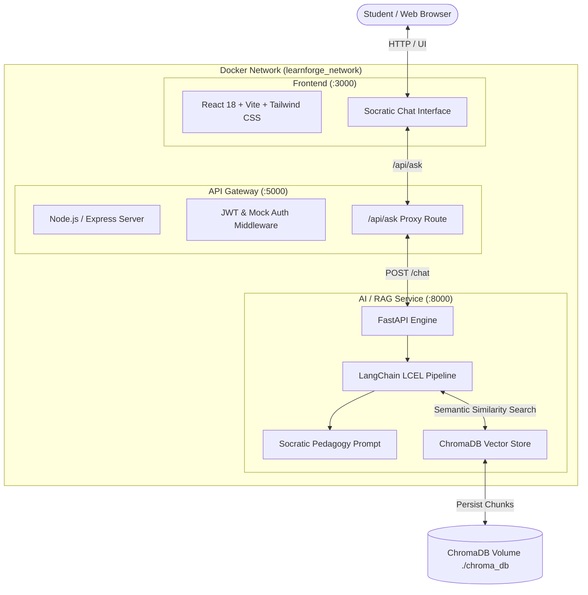

# 🏛️ Learnforge — Socratic AI Learning Platform

> An inquiry-driven learning platform that replaces passive rote memorization with guided Socratic discovery, powered by LangChain, ChromaDB, FastAPI, Express, and React.

---

## 📖 Overview

**Learnforge** is an intelligent educational platform designed around the **Socratic Method**. Rather than directly giving students the answers to their homework or code problems, Learnforge acts as a patient philosophical mentor:

- 🔍 **Scaffolds Understanding**: Breaks complex questions down into foundational assumptions.
- 🚫 **No Direct Answers**: Deflects requests for quick answers, asking thought-provoking follow-ups instead.
- 📚 **Grounded in Course Materials**: Uses Retrieval-Augmented Generation (RAG) backed by ChromaDB vector storage to anchor questions in textbooks, syllabi, and reference documents.
- 💡 **Thinking Hints**: Provides subtle conceptual analogies and thought experiments when students get stuck.

---

## 🏗️ System Architecture



---

## 📁 Repository Structure

```text
learnforge/
├── .env.example                     # Environment template for Docker & services
├── .gitignore                       # Multi-stack gitignore rules
├── docker-compose.yml               # Multi-container stack orchestration
├── package.json                     # Monorepo convenience scripts
├── setup.ps1                        # Automated setup script for Windows PowerShell
├── setup.sh                         # Automated setup script for Linux / macOS
│
├── backend-ai/                      # 🐍 Python / FastAPI Socratic RAG Service
│   ├── Dockerfile
│   ├── .dockerignore
│   ├── config.py                    # ChromaDB, paths, & LLM configuration
│   ├── create_dummy_docs.py         # Pure-Python educational PDF generator
│   ├── ingest.py                    # PDF Loader, text splitter, & ChromaDB indexing
│   ├── main.py                      # FastAPI app with /chat, /ingest, /health
│   ├── rag_service.py               # LangChain pipeline & Socratic prompt chain
│   ├── requirements.txt             # Python dependencies
│   └── docs/                        # Educational course materials (PDFs)
│       ├── binary_search_fundamentals.pdf
│       ├── recursion_and_call_stacks.pdf
│       └── socratic_pedagogy_principles.pdf
│
├── backend-node/                    # 🟢 Node.js / Express API Gateway
│   ├── Dockerfile
│   ├── .dockerignore
│   ├── package.json
│   └── src/
│       ├── index.js                 # Server entrypoint with dynamic CORS & Helmet
│       ├── config/env.js            # Environment parsing & allowed origins
│       ├── middleware/
│       │   └── authMiddleware.js    # JWT verification & mock authentication
│       └── routes/
│           ├── askRoutes.js         # Proxy route /api/ask -> FastAPI /chat
│           └── authRoutes.js        # /register, /login, /me endpoints
│
└── frontend/                        # ⚛️ React / Vite Web Client
    ├── Dockerfile
    ├── .dockerignore
    ├── index.html                   # HTML entrypoint
    ├── package.json
    ├── postcss.config.js
    ├── tailwind.config.js           # Tailwind theme configuration
    ├── vite.config.js               # Dev server & proxy to Node gateway
    └── src/
        ├── main.jsx                 # React root render
        ├── App.jsx                  # Main container
        ├── index.css                # Tailwind directives
        └── components/
            └── ChatInterface.jsx    # Socratic inquiry chat interface
```

---

## 🛠️ Tech Stack

| Layer | Technologies | Description |
|---|---|---|
| **Frontend** | React 18, Vite 5, Tailwind CSS | Responsive, accessible chat UI with message history, inquiry bar, and source citations |
| **API Gateway** | Node.js 20, Express, JWT, Axios, CORS, Helmet | Secure gateway handling user auth, request validation, and proxying |
| **AI / RAG Engine** | Python 3.11, FastAPI, LangChain, ChromaDB, PyPDF | Semantic document retrieval and strict Socratic prompt orchestration |
| **DevOps** | Docker, Docker Compose | Single-command containerized local and cloud deployment |

---

## 🚀 Getting Started

### Option 1: Quickstart with Docker Compose (Recommended)

Make sure you have [Docker Desktop](https://www.docker.com/products/docker-desktop/) installed and running.

```bash
# 1. Clone the repository
git clone https://github.com/keshavchaudhary2006/learnforge.git
cd learnforge

# 2. (Optional) Set your OpenAI API key
cp .env.example .env
# Edit .env and paste your OPENAI_API_KEY (optional: fallback works offline)

# 3. Build and launch all 3 services
docker compose up --build
```

Access points:
- **Frontend Chat UI**: [http://localhost:3000](http://localhost:3000)
- **Node.js Express Gateway**: [http://localhost:5000](http://localhost:5000)
- **FastAPI Interactive Docs**: [http://localhost:8000/docs](http://localhost:8000/docs)

---

### Option 2: Local Development Setup (Without Docker)

#### Windows (PowerShell)
```powershell
.\setup.ps1
```

#### macOS / Linux (Bash)
```bash
chmod +x setup.sh
./setup.sh
```

#### Running Services in Separate Terminals:

1. **Terminal 1: AI RAG Service (`backend-ai`)**
   ```bash
   cd backend-ai
   python -m venv .venv
   .\.venv\Scripts\activate   # Windows (or: source .venv/bin/activate on Unix)
   pip install -r requirements.txt
   python ingest.py           # Generates sample PDFs and indexes them in ChromaDB
   uvicorn main:app --reload --port 8000
   ```

2. **Terminal 2: Express Gateway (`backend-node`)**
   ```bash
   cd backend-node
   npm install
   npm run dev
   ```

3. **Terminal 3: React Frontend (`frontend`)**
   ```bash
   cd frontend
   npm install
   npm run dev
   ```

---

## 📚 Ingesting Course Documents (ChromaDB)

To add your own educational materials (lecture notes, textbooks, articles) to Learnforge:

1. Drop `.pdf` files into the [`backend-ai/docs/`](file:///c:/Users/Arjun%20%20Chaudhary/Documents/antigravity/friendly-salk/backend-ai/docs) directory.
2. Run the ingestion script:
   ```bash
   cd backend-ai
   python ingest.py
   ```
   Or trigger it via HTTP POST while the server is running:
   ```bash
   curl -X POST http://localhost:8000/ingest
   ```

The script will split documents into 500-character semantic chunks with 100-character overlap and index them into the persistent ChromaDB collection.

---

## 📡 API Reference

### Express API Gateway (`http://localhost:5000`)

| Method | Endpoint | Description | Auth Required |
|---|---|---|---|
| `POST` | `/api/ask` | Proxies student question to FastAPI `/chat` with user context | Optional (`Bearer <token>`) |
| `POST` | `/api/auth/register` | Registers a student and returns a signed JWT token | No |
| `POST` | `/api/auth/login` | Authenticates student credentials and returns a JWT token | No |
| `GET` | `/api/auth/me` | Fetches the authenticated user profile | Yes (`Bearer <token>`) |
| `GET` | `/health` | Gateway health check and service uptime | No |

#### Example Request (`POST /api/ask`):
```json
{
  "question": "Why does binary search require a sorted array?",
  "topic": "Algorithms",
  "chat_history": []
}
```

#### Example Response:
```json
{
  "success": true,
  "data": {
    "question": "Why does binary search require a sorted array?",
    "socratic_response": "That's a vital question in algorithmic efficiency! Imagine you have a physical telephone directory where names are shuffled completely at random. If you open to the exact middle page and see 'Miller', what could you deduce about whether 'Adams' is in the left half or right half?\n\nWhat mathematical guarantee does an ordered sequence give you when you compare a target against the middle element?",
    "sources": [
      {
        "source": "binary_search_fundamentals.pdf",
        "page": 1,
        "snippet": "Why sorting is required: If elements are unsorted, you cannot eliminate half of the remaining elements..."
      }
    ],
    "topic": "Algorithms"
  },
  "metadata": {
    "student": { "id": "mock_usr_101", "name": "Alex Rivera" },
    "proxyTimestamp": "2026-03-29T18:45:00.000Z"
  }
}
```

---

### FastAPI AI Service (`http://localhost:8000`)

| Method | Endpoint | Description |
|---|---|---|
| `POST` | `/chat` | Socratic RAG pipeline: retrieves ChromaDB context & generates guiding questions |
| `POST` | `/ingest` | Triggers indexing of all PDFs in the `docs/` directory |
| `GET` | `/health` | ChromaDB vector store connection status |
| `GET` | `/docs` | Interactive Swagger API documentation |

---

## ⚙️ Environment Variables

Copy [`.env.example`](file:///c:/Users/Arjun%20%20Chaudhary/Documents/antigravity/friendly-salk/.env.example) to `.env`:

```env
# AI Service & Embeddings
OPENAI_API_KEY=your_openai_api_key_here
EMBEDDING_MODEL=text-embedding-3-small
LLM_MODEL=gpt-4o-mini
CHROMA_PERSIST_DIRECTORY=./chroma_db
CHROMA_COLLECTION_NAME=learnforge_educational_materials

# Node.js API Gateway
PORT=5000
AI_SERVICE_URL=http://backend-ai:8000
JWT_SECRET=learnforge_super_secret_jwt_key_2026
CLIENT_ORIGINS=http://localhost:3000,http://localhost:5173
```

> **Note**: Learnforge features an automatic offline pedagogical simulator with deterministic local embeddings. You can test the full pipeline and UI immediately even without an OpenAI API key!

---

## 🤝 Contributing

Contributions to improve pedagogy prompts, vector indexing, or UI components are welcome!

1. Fork the Project
2. Create your Feature Branch (`git checkout -b feat/AmazingFeature`)
3. Commit your Changes (`git commit -m 'feat: add AmazingFeature'`)
4. Push to the Branch (`git push origin feat/AmazingFeature`)
5. Open a Pull Request

---

## 📄 License

Distributed under the MIT License. See `LICENSE` for more information.
